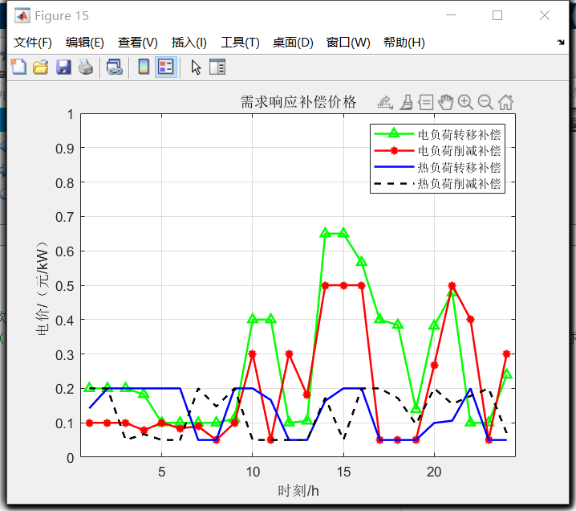
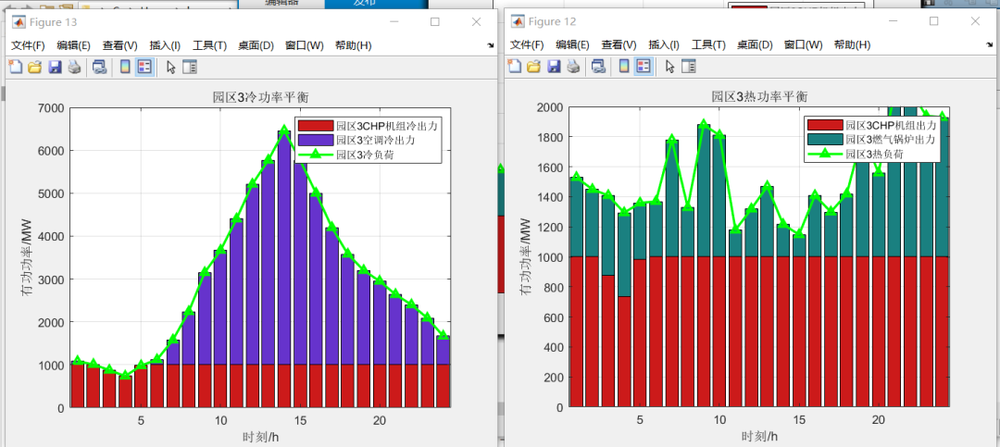
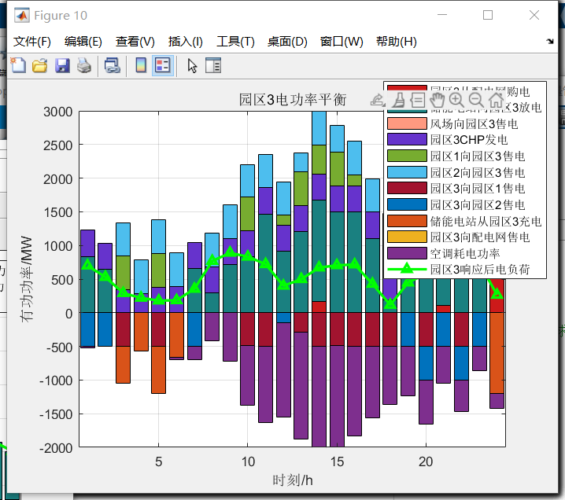
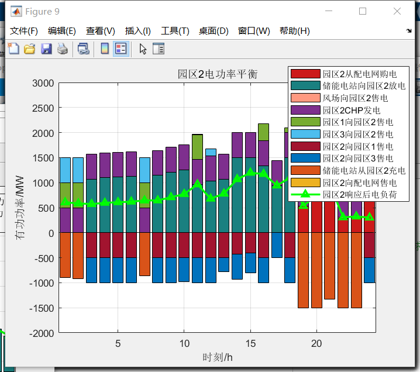
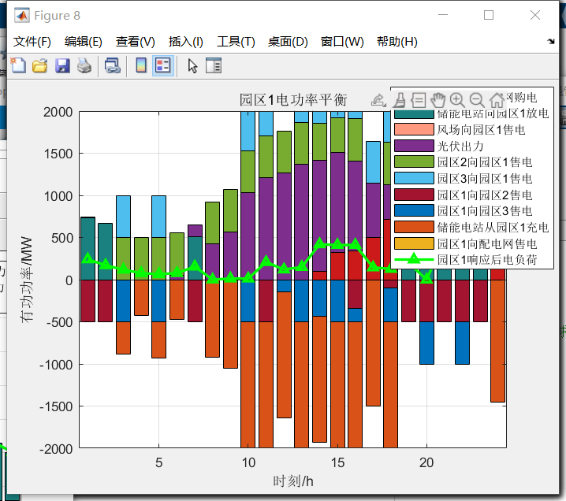
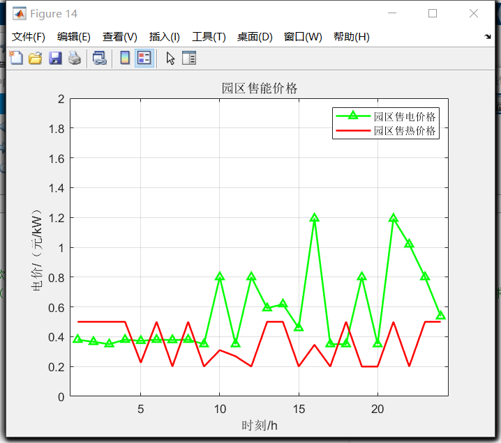
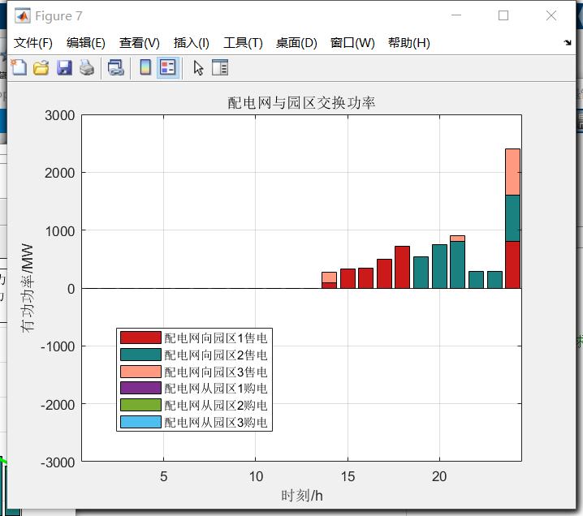
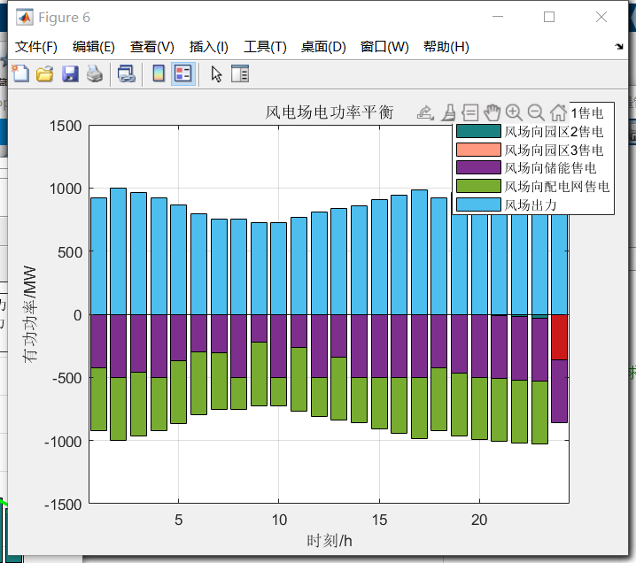
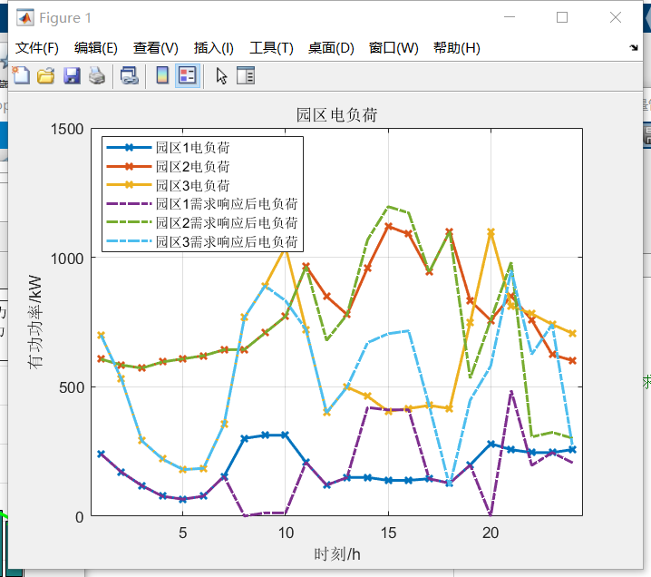

# Dynamic Pricing and Energy Management of Integrated Electrical Energy System Based on Master-Slave Game (Matlab Code Implementation)

Dynamic Pricing and Energy Management of Electrothermal Comprehensive Energy System Based on Master-Slave Game (Matlab Code Implementation)
Run Result:
\n        \n      \n        \n      \n        \n      \n        \n      \n        \n      \n        \n      \n        \n      \n        \n      \n        \n      \n        \n  

## Images

<!-- PAYMENT_BLOCK -->

## Get this dataset

- Payment link (Stripe): [Buy now](https://buy.stripe.com/3cs8yP7sY87d0vu9AB)
- Payment QR code: 

<!-- /PAYMENT_BLOCK -->
